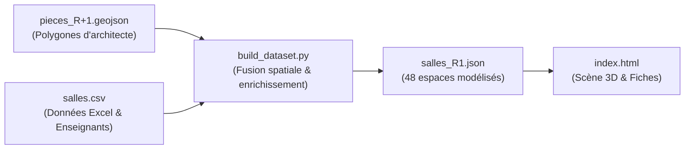
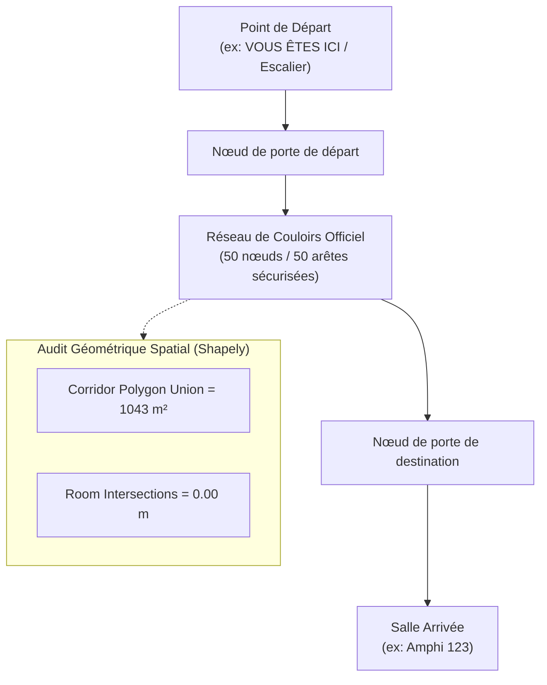

# Rapport Explicatif & Technique : Jumeau Numérique 3D ensIIE (Étage R+1)

Ce document récapitule l'ensemble de l'architecture, des outils, des algorithmes et des choix de conception mis en œuvre dans la réalisation de la plateforme.

---

## 1. Introduction & Objectif du Projet

Le projet **« Jumeau Numérique 3D & Navigation Indoor »** pour l'école **ensIIE** a pour objectif de concevoir une réplique numérique tridimensionnelle interactive du bâtiment principal (focalisée sur le premier étage **R+1**), accompagnée d'un système de guidage et d'orientation intérieure autonome.

### Les défis clés résolus :
1. **Fidélité architecturale absolue** : Aucun espace inventé. Les 48 espaces sont issus des plans d'architecte officiels et du registre de l'école.
2. **Circulation réaliste** : Le cheminement d'orientation passe exclusivement par les **couloirs officiels d'évacuation**. Aucune salle n'est traversée (les portes des salles de cours étant souvent verrouillées en dehors des cours).
3. **Guidage pas à pas** : Génération d'instructions de direction (flèches ⬆️, ↰, ↱) avec distances et repères visuels.
4. **Accessibilité PMR** : Détection des personnes à mobilité réduite pour adapter l'itinéraire via l'ascenseur sans escalier.
5. **Autonomie technique** : Fonctionnement fluide dans n'importe quel navigateur moderne, sans dépendance lourde, exécutable localement ou via un serveur web standard.

---

## 2. Pile Technologique & Outils Utilisés

| Composant | Technologie | Justification |
| :--- | :--- | :--- |
| **Moteur 3D** | **Three.js (r128)** & **OrbitControls** | Librairie WebGL standard de l'industrie, performante, intégrée localement (`three.min.js`) pour garantir un fonctionnement hors-ligne sans dépendance à des CDN externes. |
| **Interface Utilisateur** | **HTML5 / CSS3 / JavaScript (Vanilla ES6)** | Aucun framework lourd (React/Vue/Angular) n'a été requis, permettant un chargement instantané (< 1 seconde), une portabilité maximale et un fichier unique facile à maintenir. |
| **Calcul Géométrique** | **Python 3 & Shapely** | Audit topologique rigoureux. Shapely a permis de calculer l'union des polygones de salles et de vérifier par intersection spatiale que **100% des segments de couloirs ont 0,00 m d'empiètement sur les salles**. |
| **Algorithme d'Itinéraire** | **Dijkstra (JavaScript)** | Algorithme de théorie des graphes calculant le chemin le plus court en temps polynomial pondéré par les distances euclidiennes réelles en mètres. |
| **Données Géographiques** | **GeoJSON (`pieces_R+1.geojson`)** | Format standardisé décrivant les coordonnées 2D des polygones réels de chaque pièce et couloir. |
| **Données Métier** | **CSV / JSON (`salles.csv`, `salles_R1.json`)** | Inventaire complet des enseignants, 18 bureaux, capacités, surfaces, typologies et plannings d'occupation. |
| **Gestion de Version** | **Git & GitHub** | Dépôt distant collaboratif synchronisé sur la branche principale `main` : [github.com/Agathe-lcn/Jumeau-numerique](https://github.com/Agathe-lcn/Jumeau-numerique). |

---

## 3. Données Réelles & Modélisation (Zéro Invention)

L'application intègre **uniquement les données authentiques** fournies par l'école ensIIE :



### Données intégrées :
- **48 espaces réels modélisés** :
  - **3 Amphithéâtres** : Amphi 101, Amphi 102, Amphi 123
  - **4 Salles de TP Informatique** : 127, 130, 131, 133
  - **10 Salles de TD** : 121, 122, 126, 135, 136, 138, 139, 141, 148, 149
  - **18 Bureaux d'enseignants** : Bureaux 104 à 111, 112, 113, 114, 117, 118 à 120, 143, 144, 146 (avec les noms des enseignants correspondants : Massinissa Merabet, Vathana Ly Vath, Mathilde Mougeot, Nicolas Brunel, Abass Sagna, Catherine Dubois, David Roussel, etc.)
  - **1 Rotonde centrale** : Salle 103 (vie étudiante & carrefour central)
  - **1 Salle des Professeurs** : Salle 115
  - **Locaux Techniques & Serveurs** : 116 (Reprographie), 129, 137, 140, 142
  - **Dépôts Pédagogiques** : 124, 125, 128, 132, 134, 150
- **Photographies réelles** : 15 photographies de salles ensIIE (`103.jpeg`, `115.jpeg`, `122.jpeg`, `130.jpeg`...) intégrées et consultables en plein écran via un lightbox interactif.
- **Identité visuelle ensIIE** : Logo officiel haute résolution à barres or/argent/bronze et photo réelle d'accueil du campus.

---

## 4. Moteur 3D & Visualisation Spatiale (Three.js)

### A. Extrusion 3D Dynamique
Chaque pièce est construite à partir de son polygone GeoJSON exact :
1. Les points 2D $(x, y)$ sont convertis en un `THREE.Shape`.
2. Le volume 3D est généré via `THREE.ExtrudeGeometry` avec une hauteur paramétrée selon le type d'espace (ex. Amphithéâtres à 4.2 m, salles TD/TP à 3.2 m, bureaux à 2.6 m, rotonde à 5.0 m).
3. Le plancher est basculé à l'horizontale (`rotation.x = -Math.PI / 2`) pour aligner l'axe $Y$ en hauteur verticale et $(X, Z)$ sur le sol.

### B. Palette de Couleurs Contrôlée (Différenciation Maximale)
Pour supprimer la confusion des nuances de bleu, chaque typologie a reçu une couleur primaire vive et contrastée :

| Typologie | Couleur Hex | Description |
| :--- | :--- | :--- |
| **Amphithéâtres** | `#ef4444` | Rouge vif carmin |
| **Salles de TP Info** | `#06b6d4` | Cyan / Turquoise électrique |
| **Salles de TD** | `#f97316` | Orange vif |
| **Bureaux Enseignants** | `#10b981` | Vert Émeraude |
| **Rotonde 103** | `#a855f7` | Violet Royal |
| **Salle des Professeurs 115** | `#eab308` | Jaune d'Or |
| **Locaux Techniques & Serveurs** | `#475569` | Gris Ardoise foncé |
| **Dépôts & Réserves** | `#9ca3af` | Gris clair argenté |

### C. Étiquettes 3D Flottantes (`THREE.Sprite`)
Au-dessus de chaque espace flotte une étiquette 3D dynamique face caméra (*billboard sprite*), générée par un élément `<canvas>` 2D invisible avec bordure aux couleurs de la catégorie, affichant le numéro et le libellé de la salle.

### D. Géolocalisation Intérieure (« 📍 VOUS ÊTES ICI »)
Un repère visuel composé d'un anneau bleu pulsant au sol (`THREE.RingGeometry` avec animation trigonométrique $\sin(\omega t)$) et d'un badge flottant signale la position de départ de l'utilisateur devant l'escalier principal du R+1.

---

## 5. Algorithme de Navigation & Graphe des Couloirs

### A. La Contrainte Majeure : Interdiction de Traverser les Salles
Dans un bâtiment scolaire, les couloirs sont les seules voies de circulation garanties ouvertes. Les chemins directs en ligne droite « à travers les murs » sont irréalistes et inutilisables.



### B. Conception du Graphe Topologique (`graph_R1.json`)
- **50 nœuds de circulation** placés strictement sur la ligne médiane des couloirs du plan d'évacuation :
  - **Hub Sud** : Escalier Principal, Hall Sud, Ascenseur PMR, accès Rotonde 103.
  - **Couloir Sud** : Desserte des bureaux 104 à 111 et de la salle des profs 115.
  - **Couloir Ouest** : Desserte des bureaux 112-113, 118-120 et des salles 121, 126.
  - **Colonne Centrale (Spine)** : Artère centrale principale passant entre la salle 130 et la salle 138, sans jamais entrer dans aucune salle.
  - **Branche Nord-Ouest** : Desserte de l'Amphi 123, du TD 122 et du TP 133.
  - **Branche Nord-Est** : Desserte des salles 135, 136, 148, 149 et passage vers les bureaux Est (143, 144, 146).
- **Validation géométrique** : Testé automatiquement avec la bibliothèque Shapely. Chaque arête a été vérifiée contre l'union des 48 polygones : **0 mètre de traversée de salle**, 100% de passage en couloirs.

### C. Calcul Dijkstra & Tracé 3D
1. L'algorithme de Dijkstra calcule la suite ordonnée de nœuds minimisant la distance totale :
   $$\min \sum_{(u, v) \in \text{path}} \text{dist}(u, v)$$
2. Les coordonnées sont interpolées par une spline tridimensionnelle `THREE.CatmullRomCurve3` à tension contrôlée ($0.15$).
3. Un tube 3D lumineux (`THREE.TubeGeometry`) bleu néon traverse les couloirs à $45\text{ cm}$ au-dessus du sol.

---

## 6. Moteur de Guidage Pas à Pas (Turn-by-Turn)

Pour chaque itinéraire calculé, l'application génère un carnet de route détaillé avec flèches directionnelles :

### A. Calcul Trigonométrique des Virages
Pour trois nœuds consécutifs $P_{i-1}$, $P_i$, $P_{i+1}$ :
1. Calcul des vecteurs :
   $$\vec{v}_1 = P_i - P_{i-1}, \quad \vec{v}_2 = P_{i+1} - P_i$$
2. Angles de cap :
   $$\theta_1 = \text{atan2}(v_{1.y}, v_{1.x}), \quad \theta_2 = \text{atan2}(v_{2.y}, v_{2.x})$$
3. Déviation angulaire normalisée $\Delta\theta = \text{normalize}(\theta_2 - \theta_1) \in [-\pi, \pi]$ :
   - $|\Delta\theta| \le 25^\circ$ $\longrightarrow$ ⬆️ **Continuer tout droit**
   - $25^\circ < \Delta\theta \le 160^\circ$ $\longrightarrow$ ↰ **Tourner à gauche**
   - $-160^\circ \le \Delta\theta < -25^\circ$ $\longrightarrow$ ↱ **Tourner à droite**

### B. Affichage UI
Chaque étape apparaît sous forme d'une carte stylisée avec :
- Icône directionnelle colorée (Vert = Départ, Bleu ciel = Tout droit, Orange = Virage gauche, Jaune = Virage droite, Violet = Destination).
- Distance en mètres du segment.
- Point de repère du couloir (nom de la bifurcation ou salle adjacente).
- Bannière de synthèse : distance totale et temps de marche estimé (vitesse moyenne $1.2\text{ m/s}$).

---

## 7. Ergonomie de l'Interface (UI/UX)

- **En-tête épinglé (*sticky*)** : La barre de recherche et les filtres (`Tous`, `Amphis`, `Salles TP`, `Salles TD`, `Bureaux`, `Libres`) restent toujours fixés en haut de la barre latérale. Ils ne sont jamais recouverts par la photo ou le défilement des fiches.
- **Fiche détaillée pliable** : Un bouton « ✕ Fermer la fiche » permet de revenir à tout moment au répertoire des salles.
- **Bouton d'action rapide** : Sur chaque fiche salle, un bouton « 📍 Y aller depuis l'entrée » calcule immédiatement l'itinéraire 3D sans avoir à changer d'onglet manuellement.
- **Mode Sombre Professionnel** : Palette de couleurs bleu nuit / ardoise inspirée des standards industriels, offrant une excellente lisibilité et un confort visuel optimal.

---

## 8. Organisation des Fichiers & Déploiement

Le projet sur GitHub (`https://github.com/Agathe-lcn/Jumeau-numerique`) est organisé de façon propre et modulaire :

```text
├── index.html            # L'application Web 3D complète autonome
├── three.min.js          # Moteur 3D Three.js local
├── OrbitControls.js      # Module de contrôle caméra
├── images/               # Photos des salles + logos ensIIE
├── salles_R1.json        # Base de données JSON des 48 espaces
├── graph_R1.json         # Graphe officiel des couloirs (50 nœuds)
├── build_app.py          # Script Python de build / régénération
├── build_clean_graph.py  # Script Python de validation des couloirs
├── build_dataset.py      # Script Python de traitement des données sources
├── pieces_R+1.geojson    # Fichier source d'architecte (polygones)
├── salles.csv            # Fichier source Excel (salles et professeurs)
├── images_b64.json       # Base64 pré-encodé des images statiques
├── plan_R+1.png          # Plan d'évacuation R+1 officiel
└── README.md             # Documentation d'accueil du dépôt
```

### Exécution locale :
Dans le dossier du projet, lancez :
```bash
python -m http.server 8080
```
Puis ouvrez **`http://localhost:8080`** dans Chrome ou tout navigateur moderne.
